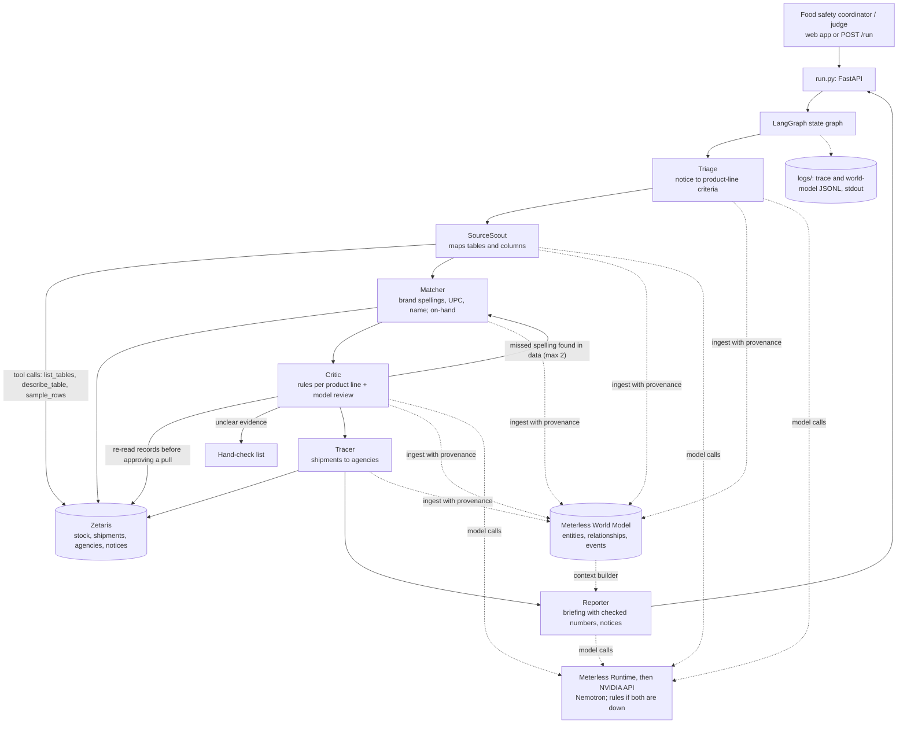

<p align="center"></p>

# Lotline

Multi-agent recall tracing for food banks. When a recall lands, Lotline tells a food bank which stock is affected, where it is, and which partner agencies already received it, with the evidence for every item.

| | |
|---|---|
| **Track** | Solving Fragmented Intelligence, Open Agent Hackathon 2026 |
| **Built with** | Zetaris, Meterless World Model engine, NVIDIA Nemotron |
| **Team** | Illusionists: [Priyanshu Singh](https://github.com/prxcode), [Vaibhavi Singh](https://github.com/codedivaa) |
| **Demo** | [Video](TODO) · [Slides](TODO) |

## In brief

| | |
|---|---|
| **User** | The food safety coordinator at a regional food bank |
| **Problem** | Stock is logged by volunteers (misspelled brands, missing barcodes, smudged codes) in systems separate from the shipment log, so tracing a recall takes hours and items get missed |
| **In** | One recall notice, plus the stock records, shipment log and agency list, read through Zetaris |
| **Out** | A pull list with shelves and quantities, a list of packages to check by hand, a drafted notice per agency, the evidence for each item, and an audit trail |
| **Why an agent** | Every food bank names its columns differently, brand spellings can't be listed in advance, and each item has different evidence. The agents discover the columns, find the spellings, send unclear items to a person and loop back when a spelling was missed. A single prompt can't cite source rows and forgets approvals. Scope: one food recall at a time |

## The problem

A food bank has to answer three questions fast:

1. Do we have the recalled product?
2. Where is it?
3. Has any of it already gone out to partner agencies?

The answers sit in separate systems. Notices list product lines with their own barcodes, lot codes and dates. Volunteers write "Natures Own" or "HC Farms", donated items often have no barcode, and codes get smudged. Lotline does the trace in seconds.

## How it works

Six agents run as a LangGraph state graph:

| Agent | Role |
|---|---|
| Triage | Turns each recalled product line into checkable criteria and gathers known brand spellings |
| SourceScout | Maps each table and column to its meaning; in live mode Nemotron does this with tool calls, checked before use |
| Matcher | Finds stock by brand spelling, barcode and product name; works out what is still on hand |
| Critic | Judges every item with the rules; Nemotron reviews and may escalate to a person, never confirm or clear. Sends the Matcher back if a spelling was missed (max 2 rounds) |
| Tracer | Follows flagged stock into shipments to agencies |
| Reporter | Builds the pull list, hand checks, agency notices and a briefing whose numbers are all checked |

### Decision rules

Each item is checked against each product line; the most serious result wins. Lot and date from different lines are never combined.

| Evidence | Result |
|---|---|
| Barcode differs, or clearly another brand, product or size | Not this product |
| All codes match and the barcode matches | Pull |
| No barcode, but brand, name and a specific lot match (or lot and date both match) | Pull |
| Weaker evidence: brand only resembles, "all lots", or a date alone | Check by hand |
| A needed code is missing, unreadable (`241X`) or the codes disagree | Check by hand |
| The notice lists no codes for this line | Check by hand |
| Codes outside the notice | Ruled out (near miss if within 5 of a recalled lot) |

### Guardrails

- Codes, barcodes and dates are parsed by rules; the model never sets them.
- Rules decide every verdict. Nemotron can escalate an item, never confirm or clear one.
- A brand found only by resemblance is never confirmed without a barcode until a person approves the spelling.
- Every number in the briefing is checked; an invented one gets the briefing rebuilt from the counts.

### When something fails

| Failure | What happens |
|---|---|
| Zetaris unreachable | Continues on the local copy in `data/` and says so (`DATA_FALLBACK=false` turns this off) |
| Nemotron error or rate limit | Tries the fallback model, then the rules alone; same decisions, flagged in the report (`LLM_FALLBACK=false` turns this off) |
| Model proposes a column that doesn't exist | Rejected; the name-based mapping is used |
| Model invents a number | Rejected; the briefing is rebuilt from the counts |
| A missed brand spelling | The Critic sends the Matcher back, at most twice |

**Source citations.** Every item and shipment says where it came from (`inventory.csv line 122`, or `table key=value` on Zetaris).

**Spelling memory.** When a person confirms a close spelling, it is stored and the recall is checked again. A spelling the model suggests is never stored on its own.

**Shared world model.** Agents write what they find into a SQLite store with stable IDs, provenance and relationships; every write is also logged to `logs/world-<run_id>.jsonl`.

**Audit trail.** Every agent step writes a JSON line to `logs/trace-<run_id>.jsonl`, contact details redacted.

## Architecture



Not a fixed chain: the Critic can loop back to the Matcher, send items to a person, and re-reads records before any pull.

## Sponsor technology

| | Role in Lotline | Where |
|---|---|---|
| **Zetaris** (data) | The food bank's three systems are three PostgreSQL databases registered in Zetaris as JDBC sources. Every agent reads them with SQL through one adapter (`POST /sql-editor/sqls/run`). Verified on a live instance on 23 Oct: same answers as the local copy, about 5 s per search and a minute per full check | `zetaris/`, `agents/scout.py`, `agents/critic.py` |
| **Meterless World Model engine** (memory) | Shared state with stable IDs, provenance per write, relationships, an event log per run and query endpoints. Approved spellings persist across runs | `world_model/`, `tests/test_world_model.py` |
| **Meterless Runtime** (model runtime) | Implemented as the first model provider. Not run in this build: the Windows installer was quarantined by antivirus, so live runs used NVIDIA's API. Tested against a stand-in | `llm/providers.py`, `tests/test_providers.py` |
| **NVIDIA** (models) | Nemotron 3.5 Lightning (fallback: Super VL) maps the data, suggests spellings, reviews verdicts and writes the briefing | `llm/client.py`, `agents/` |

**What is unique.** Nemotron does the open-ended work, rules make every decision, and Zetaris is the ground truth the Critic re-checks before any pull.

`python smoke_test.py` checks each layer: Zetaris, tables, Meterless Runtime and NVIDIA.

## Data

`data/` plays the food bank's systems; each CSV is one table. Details: [data/README.md](data/README.md).

| File | What |
|---|---|
| `recalls.csv`, `recall_products.csv` | 19 notices, 39 product lines |
| `inventory.csv` | 180 stock records as volunteers logged them |
| `distributions.csv` | 115 shipments |
| `agencies.csv` | 16 partner agencies |
| `answer_key.csv` | Expected verdicts, read only by `eval.py` |

- `R-001` to `R-010`: real 2026 FDA notices with invented stock; answer key written independently.
- `R-011` to `R-014`: real October 2026 notices for products this food bank doesn't hold.
- `RC-2024-001` to `005`: fictional, a regression set.

## Quick start

No keys needed: sample mode runs every agent on the bundled data.

```bash
git clone https://github.com/prxcode/lotline.git && cd lotline
python -m venv .venv
.venv\Scripts\pip install -r requirements.txt                    # Windows
# source .venv/bin/activate && pip install -r requirements.txt     # macOS / Linux
copy .env.example .env                                              # cp on macOS / Linux
.venv\Scripts\python run.py                                        # http://localhost:8000
```

Pick a recall and Lotline checks it with the rules. API docs: http://localhost:8000/docs.

Without the UI:

```bash
curl -X POST http://localhost:8000/run -H "Content-Type: application/json" -d @input_examples/example_1.json
.venv\Scripts\python run.py --input input_examples/example_2.json
.venv\Scripts\python run.py --recall R-004 --mode live
```

Docker:

```bash
docker build -t lotline .
docker run --rm -p 8000:8000 --env-file .env lotline
```

### Live mode and sponsor services

Fill in `.env` (never commit it):

| Setting | For |
|---|---|
| `NVIDIA_API_KEY` | Nemotron; free developer key from build.nvidia.com (rate-limited [VERIFY current limits]) |
| `DATA_BACKEND=zetaris`, `ZETARIS_*` | Zetaris; register the tables with `zetaris/setup.sql` first |
| `METERLESS_RUNTIME_TOKEN` | Optional, not run in this build |

Then turn on **AI suggestions** in the header (checks then run only when you press the button), or pass `--mode live`.

### Tests and evaluation

```bash
.venv\Scripts\python -m pytest -q tests                # 43 tests
.venv\Scripts\python eval.py                           # every recall against the answer key
.venv\Scripts\python eval.py --recalls R-006..R-010     # held-out FDA recalls
.venv\Scripts\python eval.py --no-aliases               # no model-suggested spellings
.venv\Scripts\python eval.py --mode live                # with Nemotron
```

### Logs

Each run prints agent steps to stdout and writes `logs/trace-<run_id>.jsonl` and `logs/world-<run_id>.jsonl`. Contact fields are redacted.

## Results

An unsafe miss is an affected or uncertain item marked safe.

**Real FDA recalls (R-001 to R-010)**

| Run | Items | Unsafe misses | Agencies | On hand |
|---|---|---|---|---|
| Held out (R-006 to R-010), one blind run | 27 / 30 | 0 | 13 / 13 | 13 / 13 |
| All 10, sample mode | 59 / 60 | 0 | 29 / 29 | 29 / 29 |
| All 10, Nemotron 3.5 Lightning (22 Oct 2026) | 59 / 60 | 0 | 29 / 29 | 29 / 29 |

The one difference: INV-0115, brand typed "Mezzeta" with no barcode. The key says pull; Lotline sends it to a person on purpose.

**Fictional recalls (RC-2024-001 to 005)**

| Run | Items | Shipments | Unsafe misses |
|---|---|---|---|
| Sample mode | 28 / 28 | 15 / 15 | 0 |
| No model-suggested spellings | 28 / 28 | 15 / 15 | 0 |
| Nemotron 3.5 Lightning (22 Oct 2026) | 28 / 28 | 15 / 15 | 0 |

**Everything together:** 87 of 88 items, 0 unsafe misses.

**A bug the live run caught (22 Oct).** Nemotron suggested "HC Farms" for Hollow Creek Farms, and a case with no barcode was confirmed for pull, which let the model confirm an item. Now a model-suggested spelling can find an item but never confirm it without a barcode. A test covers it.

Stock and answer keys are invented, so read these as evidence the rules handle real notice formats, not as a field result.

## Web app

Built for a coordinator, not an engineer: plain language, one light theme.

- **Recalls** grouped into "Needs action now", "Needs a closer look" and "Not in our stock", each with a quick look ("26 units may be ours").
- **One status block** per recall: what was recalled and what it means for us ("Pull 2 items from the shelves now").
- **Checks run in the background.** The free rules check runs when a recall opens; AI suggestions run only on request. Finished checks are reused.
- **Four steps:**
  1. **Pull from shelves**: shelf, quantity, a tick box, a printable pull list and CSV.
  2. **Check packages**: what a volunteer wrote next to what the recall says; type what's on the package and the rules decide again.
  3. **Tell agencies**: a drafted message per agency to copy or email; mark it sent. Lotline sends nothing itself.
  4. **Finish**: close the recall and print the close-out record.
- **Reasons and evidence** on every item: the source line, each rule check, the Critic's re-read, and where it was shipped.
- **Stock, Shipments and Partner agencies** pages with search and filters, showing where each table comes from.
- **History**, **Spellings**, and **Technical details** (agent track and logs, off by default in Settings).

## API

| Method | Path | Description |
|---|---|---|
| GET | `/api/health`, `/api/config` | Health; mode, model route, data backend, catalog |
| GET | `/api/recalls`, `/api/recalls/{id}`, `/api/recalls/screen` | Notices; one notice; quick screen of all |
| POST | `/run` | Run a trace and wait: `{"recall_id": "R-004", "mode": "sample"}` |
| POST / GET | `/api/runs`, `/api/runs/{run_id}`, `/api/runs/{run_id}/trace` | Start in the background; results; trace |
| POST | `/api/runs/{run_id}/items/{item_id}/reading` | Record what's printed on a package |
| GET / POST / DELETE | `/api/aliases` | Approved brand spellings |
| GET / POST | `/api/cases`, `/api/cases/{recall_id}`, `/pulled`, `/notice`, `/close` | Case status and actions |
| GET | `/api/cases/{recall_id}/record` | Printable close-out record |
| GET | `/api/stock`, `/api/shipments`, `/api/agencies` | Read-only browsing of the three systems |
| GET | `/api/runs/{run_id}/world`, `/world/events`, `/world/node/{id}` | World model for a run |
| POST | `/api/power/test` | Test each model provider |

If `API_KEY` is set, calls need an `X-API-Key` header.

## Project structure

```
lotline/
  api/main.py             FastAPI server, serves the web app
  static/                 Web app (HTML, CSS, JS, no build step)
  assets/                 Logo and favicons
  agents/                 Six agents; criteria.py, rules.py, resolve.py
  graph/lotline_graph.py  LangGraph state graph
  llm/                    Model providers and client
  zetaris/                Zetaris REST or local DuckDB, schema, setup.sql
  world_model/            Store, ingest, context builder
  data/                   Recalls, stock, shipments, agencies, answer key
  run.py                  Entry point
  eval.py, smoke_test.py, tests/
  input_examples/, output_examples/
  metadata.json           Submission metadata
```

## AI and model usage

- **Models:** NVIDIA Nemotron 3.5 Lightning, fallback Nemotron 3.5 Super VL.
- **Providers:** Meterless Runtime if running (not in this build), else NVIDIA's API, else rules alone. Each trace line records which answered.
- **Framework:** LangGraph.
- **Development:** built with Cursor and Claude Code as coding assistants; every change reviewed and tested by the team.
- **Sample mode:** `SAMPLE_MODE=true` runs every agent with rule-based stand-ins; no network or keys.

## Third-party code and licences

LangGraph and LangChain Core (MIT), FastAPI (MIT), Uvicorn (BSD-3-Clause), DuckDB (MIT), Pydantic (MIT), OpenAI Python client (Apache-2.0), python-dotenv (BSD-3-Clause), requests (Apache-2.0). The World Model follows the Meterless reference architecture (Apache-2.0). Recall facts come from public FDA notices, linked in `data/recalls.csv`.


## Limitations

- Through Zetaris a full check takes about a minute, so the app defaults to the local copy.
- The Meterless Runtime provider is tested only against a stand-in.
- Profiles live in the browser; no user accounts yet.
- Without a barcode, product identity uses word matching ("evoo" isn't known as olive oil), so such items go to a person.
- Notices are entered as structured product lines; parsing free text is future work.
- Pack counts (10ct vs 6ct) aren't compared; weights are.

## Data disclaimer

`RC-` recalls are fictional. `R-` recalls are real FDA notices with invented stock, shipments and agencies; emails use the reserved `.example` domain. Non-recalled brand names are used for realism only.

## License

MIT
